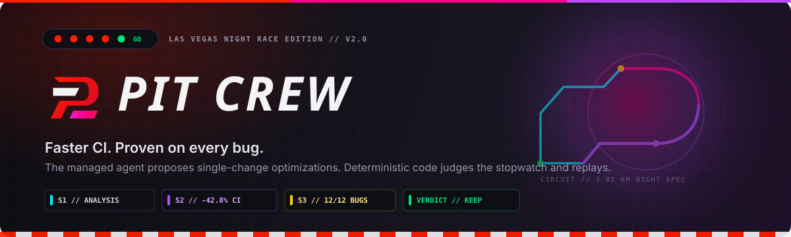
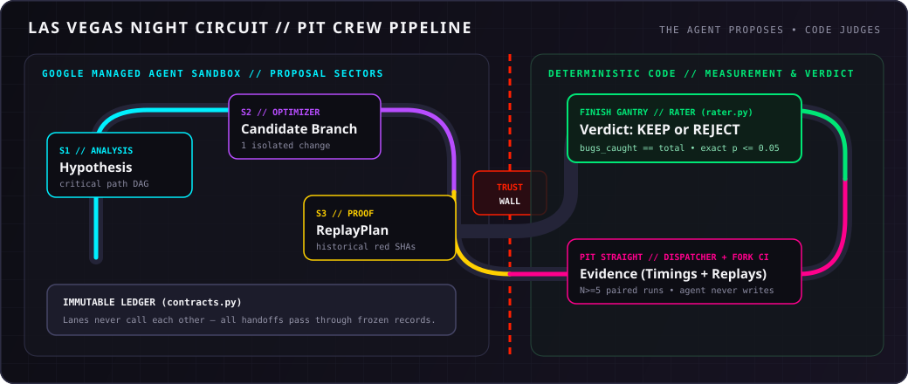

<p align="center">
  
</p>

<p align="center">
  <strong>Faster CI. Proven on every bug.</strong><br />
  <em>The agent proposes. Deterministic code judges.</em>
</p>

<p align="center">
  <a href="https://github.com/aj604/pit-crew/actions/workflows/ci.yml"></a>
  
  <a href="brand/BRAND.md"></a>
  <a href="brand/BRAND.md"></a>
  <a href="brand/BRAND.md"></a>
</p>

---

**Pit Crew** is an autonomous managed deep agent that speeds up CI pipelines and proves—through deterministic bug replays and exact permutation tests—that every historical bug is still caught.

An agent inspects your repository and run history, proposes a single targeted CI optimization on a fork branch, and selects historical red commits that must still fail. Deterministic code runs the measurements on GitHub Actions and decides whether the change is kept.

## Circuit Architecture

<p align="center">
  
</p>

> **The Red Trust Wall:** The agent never writes `Evidence` or `Verdict`, never edits `rater.py`, and never holds push credentials inside the sandbox. It proposes; `rater.py` judges from real GitHub Actions runs.

## The Five Lanes

Lanes never call each other. Every handoff flows through immutable records in the SQLite ledger ([`src/pit_crew/contracts.py`](src/pit_crew/contracts.py)), so each lane can be built and tested in isolation.

| Code | Lane | Lane Owner | Runtime / Model | Reads | Writes | Location |
|---|---|---|---|---|---|---|
| `ANA` | **Analysis** | [@TARUNSAIYAKKALA](https://github.com/TARUNSAIYAKKALA) | `gemini-4-hydrogen` | Repo, workflow DAG, run history | `Hypothesis` | [`src/pit_crew/lanes/analysis/`](src/pit_crew/lanes/analysis/) |
| `OPT` | **Optimizer** | [@mdmorsalinm](https://github.com/mdmorsalinm) | `gemini-4-neon` | `Hypothesis`, prior verdicts | `Candidate` | [`src/pit_crew/lanes/optimizer/`](src/pit_crew/lanes/optimizer/) |
| `PRF` | **Proof** | [@kreda-ship-it](https://github.com/kreda-ship-it) | `gemini-4-carbon` | `Candidate`, git history, failure artifacts | `ReplayPlan` | [`src/pit_crew/lanes/proof/`](src/pit_crew/lanes/proof/) |
| `DSP` | **Dispatcher** | [@aj604](https://github.com/aj604) | Deterministic code | Ledger, `workflow_run` webhooks | `Evidence` | [`src/pit_crew/dispatcher.py`](src/pit_crew/dispatcher.py), [`managed_agent.py`](src/pit_crew/managed_agent.py) |
| `RAT` | **Rater** | [@aj604](https://github.com/aj604) | Deterministic code | `Evidence` | `Verdict` | [`src/pit_crew/rater.py`](src/pit_crew/rater.py) |

Each agent lane is defined by a `SKILL.md` (instructions mounted into the sandbox) and a `tools.py` (host-mediated `@tool` functions).

Core platform surfaces (`contracts.py`, `ledger.py`, `server.py`, `webhooks.py`, `run_tracker.py`, `demo/`, and the Pit Wall `web/` UI) are owned by [@aj604](https://github.com/aj604). Review routing lives in [`.github/CODEOWNERS`](.github/CODEOWNERS).

## Optimizer Playbooks

Every `Hypothesis` targets one focused optimization playbook (`PLAYBOOK_SKILLS`):

| Ring | Compound | Playbook (`Hypothesis.skill`) | Strategy |
|---|---|---|---|
| 🔴 `S` | **SOFT** | `dep-cache` | Dependency & build caching |
| 🟡 `M` | **MEDIUM** | `shard-by-timing` | Timing-balanced test suite sharding |
| ⚪ `H` | **HARD** | `affected-tests` | Change-scoped test execution |
| 🟢 `I` | **INTER** | `parallelize-dag` | Unlock serial workflow DAG dependencies |
| 🟣 `HS` | **HYPER** | `dedupe-jobs` | Eliminate redundant CI jobs & steps |

## Race Control Verdicts

Pit Crew judges every candidate deterministically in [`src/pit_crew/rater.py`](src/pit_crew/rater.py) toward compounding speedups (`median <= 60s`, `p95 <= 120s`, `MIN_SPEEDUP = 1.05x`, `p <= 0.05`, `100%` replayed bugs caught):

- 🟢 **GREEN FLAG (`KEEP`)** — Statistically significant speedup (`p <= 0.05`, `N >= 5` runs per side) and `100%` of replayed bugs caught.
- 🟣 **PURPLE SECTOR** — New fastest median CI time recorded for the repository.
- 🟡 **YELLOW FLAG (`REJECT`)** — Insufficient samples (`N < 5`) or speedup not statistically significant (`p > 0.05`).
- 🔴 **RED FLAG (`REJECT`)** — Missed any historical bug replay (`bugs_caught < bugs_total`) or zero replays planned (`bugs_total == 0`).
- 🏁 **CHECKERED FLAG** — Upstream PR opened with full verified telemetry ledger.

## Quickstart & Development

No Managed Agents API key is needed to develop or test a lane. Tools are plain Python tested against fixtures and an in-memory ledger.

```sh
# Install dependencies
uv sync

# Run the full local verification suite
uv run ruff format --check
uv run ruff check
uv run mypy src tests
uv run deptry src
uv run lint-imports
uv run zizmor .github/workflows
uv run pytest
```

### Live Smoke Test

To run a lane end-to-end against the live Gemini Managed Agents API:

```sh
export GEMINI_API_KEY="your-key"
uv run python -m pit_crew.cli smoke-lane \
  --lane analysis \
  --repo owner/repo \
  --ledger ~/pit-crew-smoke/ledger.db \
  --workspace ~/pit-crew-smoke/fork
```

Omit `--workspace` (and `PIT_CREW_WORKSPACE`) to have the CLI download the repository tarball into a temporary folder for the run instead.

See the [Lane Owner Guide](docs/lane-guide.md#live-smoke-test-milestone-2) for the full chained `analysis → optimizer → proof` walkthrough.

## Locked Architecture Decisions

- **Models (Gemini 4 Managed Agents via Interactions API):** `gemini-4-hydrogen` (`analysis`), `gemini-4-neon` (`optimizer`), and `gemini-4-carbon` (`proof`, including multimodal CI failure artifact inspection).
- **Target CI Goal:** Compounding verified optimizations toward **`median <= 60s` and `p95 <= 120s`** (`MIN_SPEEDUP = 1.05x`, `p <= 0.05`, `100%` replayed bugs caught).
- **Ledger & Transport:** Event-driven `workflow_run` webhook + Pit Wall FastAPI server backed by WAL-mode `SqliteLedger` ([`src/pit_crew/ledger.py`](src/pit_crew/ledger.py)) and host-mediated `@tool` gates ([`src/pit_crew/tools.py`](src/pit_crew/tools.py)) with zero secrets inside the remote sandbox.

## Documentation

- [**Architecture**](docs/architecture.md) — End-to-end lifecycle, trust boundaries, data contracts, and platform decisions.
- [**Master Specifications**](docs/specs/) — Seven design specs that drive the remaining milestones:
  - [Spec 1A — Core Dispatcher & GitHub Actions Orchestrator](docs/specs/dispatcher-core.md)
  - [Spec 1B — Webhook Server & Pit Wall API](docs/specs/dispatcher-server.md)
  - [Spec 2 — Pit Wall UI & Telemetry Dashboard](docs/specs/pit-wall-ui.md)
  - [Spec 3 — End-to-End Integration & Live Smoke Harness](docs/specs/e2e-integration.md)
  - [Spec 3B — Cross-Lane Seam & Event-Driven Runtime Wiring](docs/specs/cross-lane-wiring.md)
  - [Spec 4A — Runtime Packaging, Webhook Ingress & Repo Governance](docs/specs/infra-and-ops.md)
  - [Spec 4B — Target Benchmark Repository & Seeded CI History](docs/specs/benchmark-target-repo.md)
- [**Lane Owner Guide**](docs/lane-guide.md) — Working agreements, `@tool` and `SKILL.md` conventions, testing, and per-lane starting points.
- [**Contributing**](CONTRIBUTING.md) — Branching, contract PR rules, and pre-merge checks.
- [**Brand Guidelines**](brand/BRAND.md) — Las Vegas Night Race visual identity, color tokens, and PR verdict templates.
- [**TODO**](TODO.md) — Active tasks, deliverables, and integration milestones per lane.

---

<p align="center">
  <picture>
    <source media="(prefers-color-scheme: dark)" srcset="brand/logo-lockup-dark.svg" />
    <source media="(prefers-color-scheme: light)" srcset="brand/logo-lockup-light.svg" />
    
  </picture>
</p>
