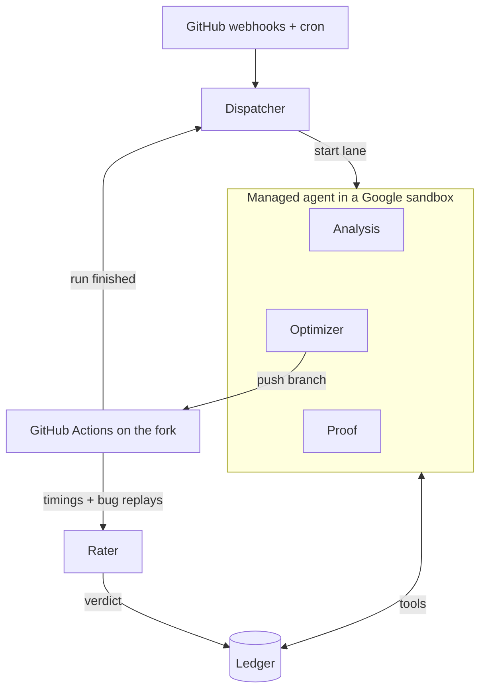

# Pit Crew

An autonomous agent that makes CI faster and proves it still catches every bug.

## Architecture



The agent proposes and code judges. The agent chooses what to try and makes the change;
the rater decides from measured runs whether it is kept.

## Lanes

Lanes never call each other. Each reads and writes records in the ledger
(`src/pit_crew/contracts.py`), so each can be built and tested alone.

| Lane | Owner | Reads | Writes | Code |
|---|---|---|---|---|
| Analysis | | repo, run history | `Hypothesis` | `src/pit_crew/lanes/analysis/` |
| Optimizer | | `Hypothesis` | `Candidate` | `src/pit_crew/lanes/optimizer/` |
| Proof | | `Candidate` | `ReplayPlan` | `src/pit_crew/lanes/proof/` |
| Rater | | `Evidence` | `Verdict` | `src/pit_crew/rater.py` |
| Dispatcher | | ledger, webhooks | `Evidence` | `src/pit_crew/dispatcher.py`, `managed_agent.py` |

A lane is a `SKILL.md` (what the agent is told) and a `tools.py` (plain functions the
agent may call). Each has a `TODO(<lane> owner)` marking where to start.

## Working on a lane

```sh
uv sync
uv run pytest -q
uv run ruff check
```

You do not need Managed Agents access to work on a lane. Tools are ordinary Python tested
against fixtures and an in-memory ledger. Only `managed_agent.py` calls the Gemini API; to
try a skill against the live agent, set `GEMINI_API_KEY` and call
`pit_crew.managed_agent.run_lane("<lane>", "<task>")`. That path has not been run against
the live API yet.

To add a tool, decorate a function in your lane's `tools.py` with `@tool`. To change a
record in `contracts.py`, open a separate PR, because every lane depends on it.

## Open decisions

- Gemini API or the Cloud Agent Platform surface for Managed Agents.
- Which database backs the ledger.
- Whether tools stay custom functions or move behind a remote MCP server.
