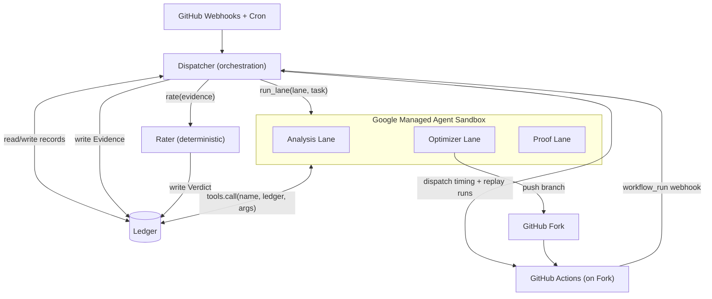
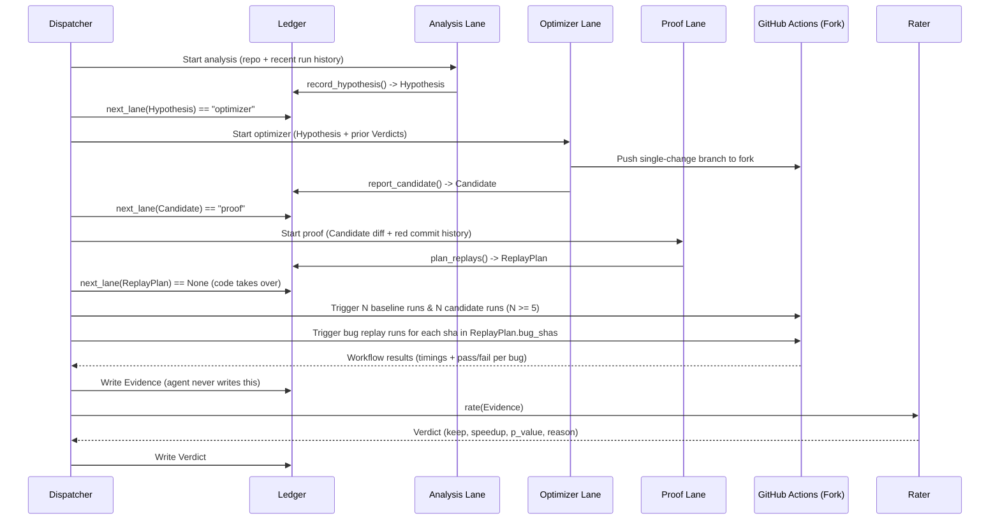

# Pit Crew Architecture

Pit Crew is an autonomous CI optimization system with one core rule: **the agent proposes, and deterministic code judges.**

The agent inspects a repository, proposes a single targeted CI optimization, pushes a branch on a fork, and selects historical bugs that must still fail. Deterministic code runs the measurements on GitHub Actions and decides whether the change is kept.

## System Overview

## End-to-End Lifecycle

Each optimization attempt moves through a strict pipeline of immutable records in `src/pit_crew/contracts.py`. Lanes never call each other directly—every handoff goes through the ledger.

### Stage-by-Stage Responsibilities

1. **Trigger → Analysis:** Cron or a webhook triggers the Dispatcher for a tracked repository. The Dispatcher starts the `analysis` lane with the repository mounted at `/workspace` and recent workflow run history. Analysis outputs one or more `Hypothesis` records, ordered by expected impact.
2. **Hypothesis → Optimizer:** The Dispatcher picks a `Hypothesis` and starts the `optimizer` lane with the hypothesis and prior ledger history for that repo (so failed approaches are not repeated). Optimizer makes **one** change on a new branch on the fork, validates workflow syntax, pushes the branch, and writes a `Candidate`.
3. **Candidate → Proof:** The Dispatcher starts the `proof` lane with the `Candidate` diff. Proof identifies which checks the candidate touches and selects historical commits that turned CI red (or synthetic mutations when history is sparse), writing a `ReplayPlan`.
4. **ReplayPlan → Measurement (Code Only):** No agent runs here. The Dispatcher triggers GitHub Actions on the fork to collect:
   - **Timing samples:** At least `MIN_RUNS = 5` runs (up to ~10) for both baseline and candidate, ideally interleaved to reduce runner-load drift.
   - **Bug replays:** Running the candidate's CI configuration against each `bug_sha` in `ReplayPlan` and checking whether CI still fails (`bugs_caught` vs `bugs_total`).
   The Dispatcher records the measured results as an `Evidence` record.
5. **Evidence → Verdict (Code Only):** `rater.rate(evidence)` runs deterministically:
   - Rejects if `bugs_total == 0` (safety unproven).
   - Rejects if `bugs_caught < bugs_total` (regression in bug detection).
   - Rejects if either side has fewer than `MIN_RUNS` timing samples.
   - Computes median speedup and an exact one-sided permutation test (`p <= 0.05`).
   - Writes a `Verdict` (`keep=True` or `keep=False`) to the ledger.
6. **Post-Verdict:**
   - If `keep=True`: The Dispatcher opens a PR (or queues the change for upstream review) with the verdict numbers and replay summary.
   - If `keep=False`: The branch is discarded or archived, and the `Verdict.reason` remains in the ledger so future Optimizer runs avoid repeating the failed approach.

## Trust & Security Boundaries

| Boundary | Rule | Why |
|---|---|---|
| **Agent vs. Rater** | The agent never writes `Evidence` or `Verdict` and never edits `rater.py`. | Prevents reward hacking (e.g., skipping tests or faking timings). |
| **Sandbox vs. CI** | The agent does not run the full CI pipeline in the sandbox; it pushes a branch and GitHub Actions measures it. | Ensures timings reflect real CI runners and prevents sandbox resource abuse. |
| **Fork vs. Upstream** | Optimizer only has push access to a dedicated fork, never upstream `main`. | Keeps untrusted/unverified branches isolated until a `Verdict(keep=True)` is produced. |
| **Lane Isolation** | Each lane interaction only receives `agent/AGENTS.md`, its own `SKILL.md`, and its own `@tool` functions. | Enforced in `managed_agent.build_request()` and tested in `tests/test_lanes.py`. |

## Data Contracts (`src/pit_crew/contracts.py`)

All cross-lane state is represented by five frozen dataclasses:

| Record | Producer | Consumers | Key Fields |
|---|---|---|---|
| `Hypothesis` | Analysis | Dispatcher, Optimizer | `repo`, `description`, `skill`, `expected_savings_seconds`, `id` |
| `Candidate` | Optimizer | Dispatcher, Proof | `hypothesis_id`, `branch`, `summary`, `id` |
| `ReplayPlan` | Proof | Dispatcher | `candidate_id`, `bug_shas`, `id` |
| `Evidence` | Dispatcher (code) | Rater | `candidate_id`, `baseline_seconds`, `candidate_seconds`, `bugs_total`, `bugs_caught`, `id` |
| `Verdict` | Rater (code) | Dispatcher, Optimizer (history) | `candidate_id`, `keep`, `speedup`, `p_value`, `reason`, `id` |

### Contract Evolution Rules

- **Separate PRs:** Any change to `contracts.py` or `ledger.py` must land in its own focused PR so every lane owner can review it.
- **Additive by default:** Prefer adding optional fields with sensible defaults over renaming or removing existing fields.
- **JSON-serializable types only:** Keep fields restricted to primitives, `tuple`, `dict`, and `None` so any future database or MCP serialization layer works cleanly.

### Known Contract & Platform Gaps to Resolve Next

These are intentionally deferred from the initial scaffold and should be agreed on before lanes depend on them:

1. **Candidate git coordinates:** `Candidate` currently stores `branch`, not `repo`, `base_sha`, or `head_sha`. Proof and Dispatcher will likely need exact SHAs to diff and run reproducible baselines.
2. **Ledger read queries:** `Ledger` currently exposes `add`, `get`, and `all`. Optimizer needs to query prior attempts/verdicts for a repo, and Dispatcher needs to track in-flight work.
3. **Synthetic mutations in `ReplayPlan`:** `ReplayPlan.bug_shas` assumes real historical commits. If Proof injects synthetic mutations for repos without red history, we need to decide whether mutations are pushed as synthetic commit SHAs or represented as structured patches in `ReplayPlan`.
4. **Optimizer playbook sub-skills:** `managed_agent.build_request()` currently mounts only `.agents/skills/{lane}/SKILL.md`. Once Optimizer adds per-fix playbooks (`dep-cache`, `shard-by-timing`, etc.), `build_request()` will need to mount the lane's additional skill files.
5. **Replay execution mechanics:** How GitHub Actions combines a `Candidate` workflow change with a historical `bug_sha` (e.g., checking out `bug_sha` and overlaying `.github/workflows/` from the candidate branch, vs. cherry-picking the bug commit onto the candidate).

## Open Architecture Decisions

None of these decisions block individual lane owners from building and unit-testing their lanes today:

| Decision | Options | What Lane Owners Can Assume Today |
|---|---|---|
| **Managed Agents runtime** | Gemini Interactions API (`google-genai`) vs. Cloud Agent Platform | **No impact on lanes.** Isolated entirely to `src/pit_crew/managed_agent.py`. |
| **Ledger storage backend** | SQLite (single-node) vs. Postgres / Firestore (hosted) | **No impact on lanes.** Program only against the `Ledger` protocol in `ledger.py` and test with `InMemoryLedger`. |
| **Tool transport** | In-process Python `@tool` functions vs. remote MCP server | **Minimal impact.** Keep `@tool` arguments/return values JSON-serializable, stateless aside from `ledger`, and documented via clear docstrings + JSON Schema. |
