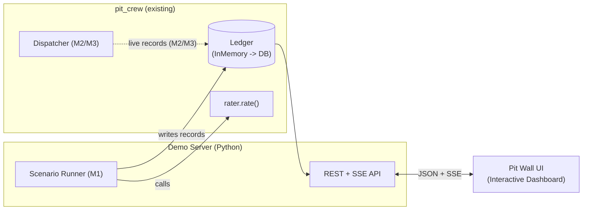

# Pit Crew Demo Specification ("Pit Wall")

## 1. Objective

Build an interactive, high-impact **Pit Wall** dashboard for demonstrating Pit Crew end-to-end. The demo must make Pit Crew's core guarantee visually unmistakable in under 3 minutes:

> **The agent proposes, and deterministic code judges.**

The demo starts from **M1 (offline end-to-end dry run)** using `InMemoryLedger`, real `contracts.py` records, and the real `rater.rate()` implementation—so it can be built and presented immediately without blocking on other lanes—and seamlessly connects to live `Dispatcher` / Managed Agent / GitHub Actions runs in **M2/M3**.

---

## 2. Demo Narrative (2–3 Minute Flow)

The UI is styled as an F1 **Pit Wall** telemetry console. A presenter walks through two contrasting runs back-to-back:

1. **The Trust Moment — Fast but Unsafe (`REJECT`):**
   - Analysis spots a slow test job and proposes an aggressive shortcut (e.g., `affected-tests`).
   - Optimizer pushes a candidate branch that cuts CI time by **~2.5×**.
   - Proof selects 4 historical red commits (`bug_shas`) that previously broke CI.
   - CI & Bug Replays run: timing looks great, **but 1 of 4 historical bugs slips through (`3/4` caught)**.
   - `rater.rate()` deterministically stamps the candidate **REJECTED** (`caught 3/4 bugs`).
2. **The Win Moment — Fast and Proven (`KEEP`):**
   - Analysis proposes `dep-cache` (or `shard-by-timing`) on the critical path.
   - Optimizer pushes a single-change workflow diff.
   - Proof replays the same 4 historical red commits.
   - Interleaved timing runs (≥ 5 baseline, ≥ 5 candidate) show a **~1.8× speedup (`p < 0.05`)** and **`4/4` bugs caught**.
   - `rater.rate()` deterministically stamps the candidate **KEPT**, ready to open a PR.

*(A third scenario, **Within Noise (`REJECT`)**, is available to show the permutation test catching statistically insignificant speedups.)*

---

## 3. Architecture & Boundaries

The demo is a **read-only observer + scenario driver** sitting alongside Pit Crew's core package. It never bypasses `contracts.py` or `rater.py`.



### Design Principles
- **Real math, never mocked verdicts:** Even in M1 offline mode, `Verdict` is always computed by calling `pit_crew.rater.rate(evidence)`.
- **Zero coupling to unfinished lanes:** M1 scenarios emit the exact `Hypothesis`, `Candidate`, `ReplayPlan`, `Evidence`, and `Verdict` dataclasses from `src/pit_crew/contracts.py`.
- **Presentation safety net:** A **`Simulated Playback` / `Live`** mode toggle lets the presenter run instant, deterministic playback if GitHub Actions or network latency is slow during a live talk.

---

## 4. UI Specification

### 4.1 Layout & Views

| Panel | Purpose | Data Source |
|---|---|---|
| **Pit Wall Header** | Repo name, mode toggle (`Playback` / `Live`), scenario selector, playback controls (`Play`, `Pause`, `Step`, `Reset`), cumulative CI time saved. | Demo controller + `Verdict` history |
| **Pipeline Tracker** | 5-stage progress bar: `Analysis → Optimizer → Proof → CI & Replays → Rater`, showing active lane, elapsed time, and status badge. | SSE stage events |
| **Timing & Permutation Chart** | Interleaved dot/strip plot of `baseline_seconds` vs. `candidate_seconds`, median markers, speedup multiplier, and exact `p_value` badge (`p ≤ 0.05` threshold). | `Evidence` + `Verdict` |
| **Bug Replay Matrix** | Table of each `bug_sha` in `ReplayPlan`, commit summary, target check, and catch status (`CAUGHT` vs. `MISSED`). | `ReplayPlan` + replay metadata + `Evidence` |
| **Verdict & Diff Card** | High-contrast `KEEP` (green) or `REJECT` (red) stamp, exact `Verdict.reason`, and syntax-highlighted workflow diff for the `Candidate`. | `Candidate` + `Verdict` |
| **Ledger Inspector** | Collapsible raw record feed showing every immutable `Record` written to the `Ledger` in real time. | `Ledger.all(...)` + SSE |

### 4.2 Playback Controls (M1)
- **Play / Pause:** Automatically advances through stages with paced delays (e.g., 1–2s per stage, animated run dots arriving one-by-one) so the audience can follow the story.
- **Step:** Advances one stage at a time for presenter-paced narration.
- **Reset / Switch Scenario:** Clears `InMemoryLedger` and loads another scenario cleanly.

---

## 5. Backend API & Event Contract

A lightweight Python server (FastAPI/Starlette) exposes:

### REST Endpoints
- `GET /api/scenarios` — Lists available M1 demo scenarios (`id`, `title`, `description`, `expected_outcome`).
- `GET /api/ledger` — Returns all current records grouped by type (`hypotheses`, `candidates`, `replay_plans`, `evidence`, `verdicts`) plus display metadata (diffs, bug commit messages).
- `POST /api/demo/start` — Body: `{ "scenario_id": "kept-dep-cache", "mode": "auto" | "step" }`. Resets ledger and begins scenario playback.
- `POST /api/demo/step` — Advances one event when in `step` mode.
- `POST /api/demo/reset` — Clears state back to idle.

### Server-Sent Events (`GET /api/events`)
Streams ordered JSON events so both M1 playback and M2/M3 live runs drive the UI identically:

```json
{ "type": "stage_changed", "stage": "analysis", "status": "running", "message": "Scanning workflow run history..." }
{ "type": "record_added", "kind": "Hypothesis", "record": { ... } }
{ "type": "timing_sample", "candidate_id": "...", "side": "candidate", "run_index": 3, "seconds": 142.4 }
{ "type": "bug_replay_result", "candidate_id": "...", "bug_sha": "a1b2c3d", "caught": true, "summary": "Fix null check in auth middleware" }
{ "type": "record_added", "kind": "Verdict", "record": { ... } }
```

---

## 6. M1 Scenario Catalog

| Scenario ID | Skill | Baseline Median | Candidate Median | Bugs Caught | Expected Verdict |
|---|---|---|---|---|---|
| `rejected-missed-bug` | `affected-tests` | ~240s | ~95s | `3 / 4` | **REJECT** (`caught 3/4 bugs`) |
| `kept-dep-cache` | `dep-cache` | ~240s | ~130s | `4 / 4` | **KEEP** (`~1.85x faster, caught 4/4 bugs`, `p < 0.05`) |
| `rejected-noise` | `dedupe-jobs` | ~240s | ~232s | `4 / 4` | **REJECT** (`speedup is within noise`) |

---

## 7. Phased Implementation Plan

### Phase 1 — M1 Offline Scenario Engine & API
- [ ] Add `demo/` (or `src/pit_crew/demo/`) with scenario definitions using `contracts.py` + `rater.rate()`.
- [ ] Implement the REST + SSE server reading from `InMemoryLedger`.
- [ ] Add unit tests verifying all 3 scenarios produce the expected `Verdict` via `rater.rate()`.

### Phase 2 — "Pit Wall" Interactive Dashboard
- [ ] Scaffold frontend (Vite + React + Tailwind or lightweight SPA) consuming `/api/ledger` and `/api/events`.
- [ ] Build the 6 UI panels (Header, Pipeline Tracker, Timing/Permutation Chart, Bug Replay Matrix, Verdict & Diff Card, Ledger Inspector).
- [ ] Polish animations, dark "Pit Wall" telemetry theme, and presenter playback controls.

### Phase 3 — Live Integration (M2 / M3)
- [ ] Connect `GET /api/ledger` to the production `Ledger` backend.
- [ ] Subscribe `GET /api/events` to live `Dispatcher` / webhook / `managed_agent.run_lane()` updates.
- [ ] Verify seamless switching between `Live` and `Simulated Playback` modes.

---

## 8. Cross-Lane Coordination

Nothing blocks Phase 1 or Phase 2. For Phase 3 (Live), coordinate with the Architecture owner on two items already tracked in `TODO.md`:
1. **Diff & commit metadata on `Candidate`:** `base_sha` / `head_sha` (or diff summary) so the UI can render real workflow diffs without extra GitHub API calls.
2. **Ledger query / subscription hooks:** Filtering records by `repo` / `candidate_id` and subscribing to new writes so the SSE stream can attach directly to the production `Ledger`.
